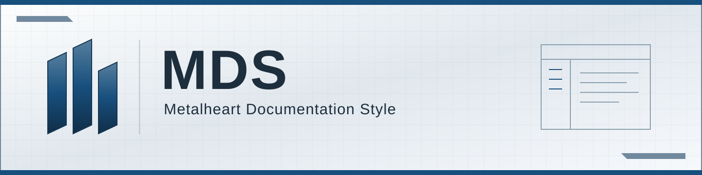
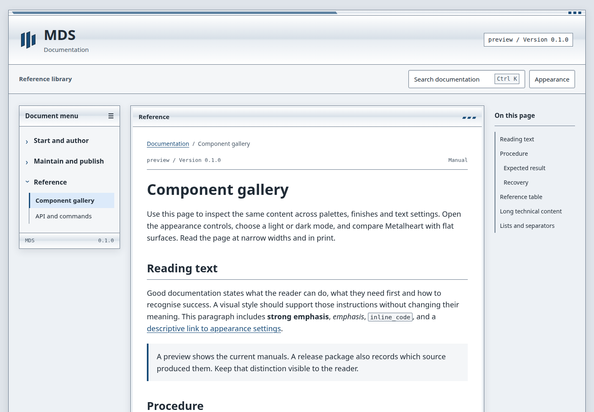
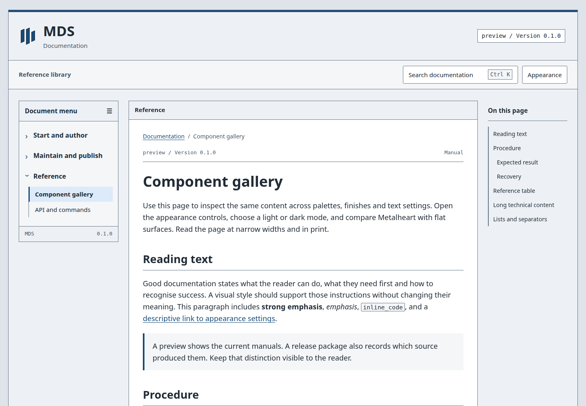

<p align="center">
  
</p>

<h1 align="center">Metalheart Documentation Style</h1>

<p align="center">Shared documentation systems. Project identity. Reader-controlled appearance.</p>

<p align="center">
  
</p>

<p align="center">
  <a href="docs/getting-started.md">Get started</a> |
  <a href="docs/themes.md">Themes</a> |
  <a href="docs/agents.md">Agent skills</a> |
  <a href="docs/index.md">Documentation</a>
</p>

<p align="center"></p>

Metalheart Documentation Style (MDS) builds static documentation sites with a
shared reading layout, local search and reader-controlled appearance. Projects
keep their own manuals, identity and release policy while using one maintained
renderer and set of controls.

Version 0.1.0 is the first development candidate. Installation uses a versioned
package archive; this repository does not imply that a public npm package or
hosted documentation service is available.

## What MDS provides

- Markdown manuals with stable heading links, explicit navigation and local search.
- Independent palette, light/dark mode, surface finish and typography controls.
- Project logos, with optional light/dark variants, preserved across themes.
- Flat or Metalheart surfaces in Appearance, contrast choices and system preferences.
- Local, pinned Git and snapshot sources with explicit release provenance.
- A command-line build, preview, checker, snapshot exporter and static package.
- Portable skills for project adoption, documentation maintenance and releases.

The result is static HTML, CSS, JavaScript and local assets. Reading and document
navigation work without JavaScript; search and saved preferences use JavaScript.
No account, search server, font service or analytics is required by MDS.

## Reading views

The same document can use Metalheart framing or flat surfaces without changing
its content or navigation.





## Quick start

Use Node.js 22 or 24 LTS and npm. Obtain the exact
`metalheart-mds-0.1.0.tgz` archive from the package maintainer, or run `npm pack`
in a prepared checkout. Keep the archive in your project's `vendor/` directory
so the lockfile has a reproducible local dependency.

From a new project directory containing that archive:

```sh
npm init -y
npm install --save-dev --save-exact ./vendor/metalheart-mds-0.1.0.tgz
npx --no-install mds init .
npx --no-install mds init . --write
npx --no-install mds build
npx --no-install mds check
npx --no-install mds preview --port 4173
```

Open `http://127.0.0.1:4173/docs/`. Stop the preview with Ctrl+C.
The first `init` prints its proposed changes; `--write` creates the starter.
It does not replace an existing project instruction file.

Edit `content/` and `mds.config.json`, then rebuild. The starter writes `_site/`
and keeps build provenance in `.mds/build.json`, outside the served directory.
For an existing project, follow [adoption and migration](docs/migration.md).

## Appearance

The default uses a neutral palette, the system's light/dark preference,
Metalheart surfaces and standard typography. Reader choices override the host's
initial selection. In Appearance, set Surface finish to Flat to remove decorative
materials, and Typography to Standard to remove text effects. Both settings
preserve focus indicators, control borders and content.

```json
{
  "themes": ["cobalt", "violet"],
  "palette": "neutral",
  "mode": "system",
  "finish": "metalheart",
  "typography": "standard",
  "contrast": "system"
}
```

Place these fields in the configuration's `appearance` object. Neutral and
Contrast are always available. Additional families include FIL Amber, AOTX Green,
FICC Silver Orange, PRISM Porcelain Orange, Cobalt and Violet. See
[themes](docs/themes.md) and the [component gallery](docs/gallery.md).

## Documentation

| Task | Guide |
| --- | --- |
| Build a first site | [Getting started](docs/getting-started.md) |
| Write and organise manuals | [Authoring](docs/authoring.md) |
| Configure a project | [Configuration](docs/configuration.md) |
| Select appearance defaults | [Themes](docs/themes.md) |
| Check inclusive reading | [Accessibility](docs/accessibility.md) |
| Bind a documentation source | [Sources and snapshots](docs/sources.md) |
| Prepare an update | [Release maintenance](docs/releases.md) |
| Install portable skills | [Agent integration](docs/agents.md) |
| Serve the output | [Hosting](docs/hosting.md) |
| Upgrade or migrate | [Migration](docs/migration.md) |
| Diagnose a failure | [Troubleshooting](docs/troubleshooting.md) |
| Use commands or the API | [Reference](docs/api.md) |

MDS targets accessible reader workflows, including keyboard navigation, zoom,
contrast and system display preferences. This is not a certification of arbitrary
authored content or host customisation. See the scope and checks in the
[accessibility guide](docs/accessibility.md).

## Develop MDS

```sh
npm ci --ignore-scripts
npm test
npm run build
```

The project builds its own manuals with MDS. See [contribution guidance](CONTRIBUTING.md)
for browser checks, meaningful regressions and package verification. Configuration,
source and theme formats are versioned. Read the [changelog](CHANGELOG.md) and
[upgrade procedure](docs/migration.md#upgrade-mds) before changing a pinned version.

## Licence and conduct

MDS code is licensed under [Apache-2.0](LICENSE). Bundled dependencies and fonts
retain their original licences and notices. Project manuals and brand assets
retain their own licences. See [NOTICE](NOTICE), [security reporting](SECURITY.md)
and the [code of conduct](CODE_OF_CONDUCT.md).
